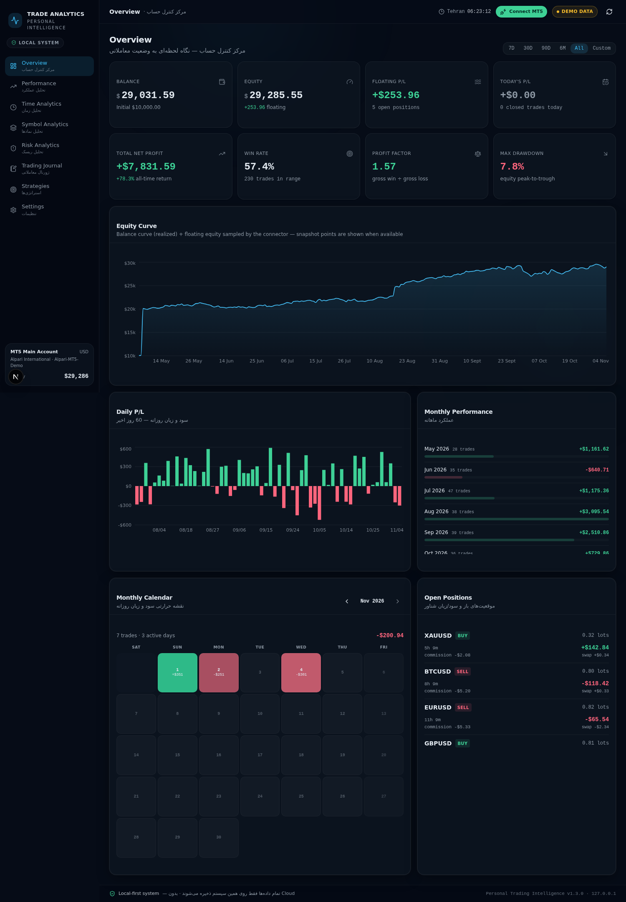
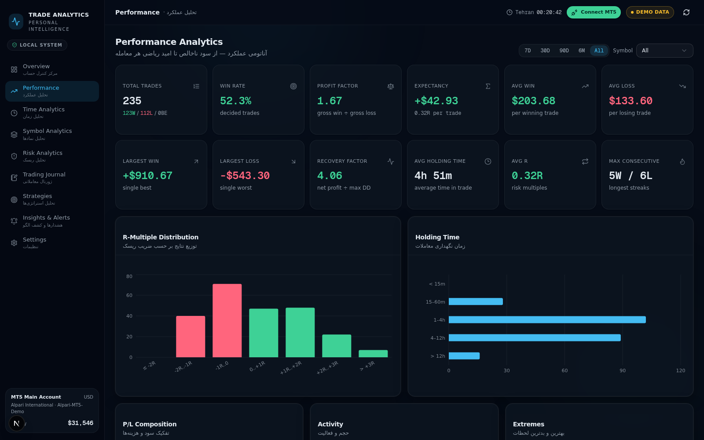
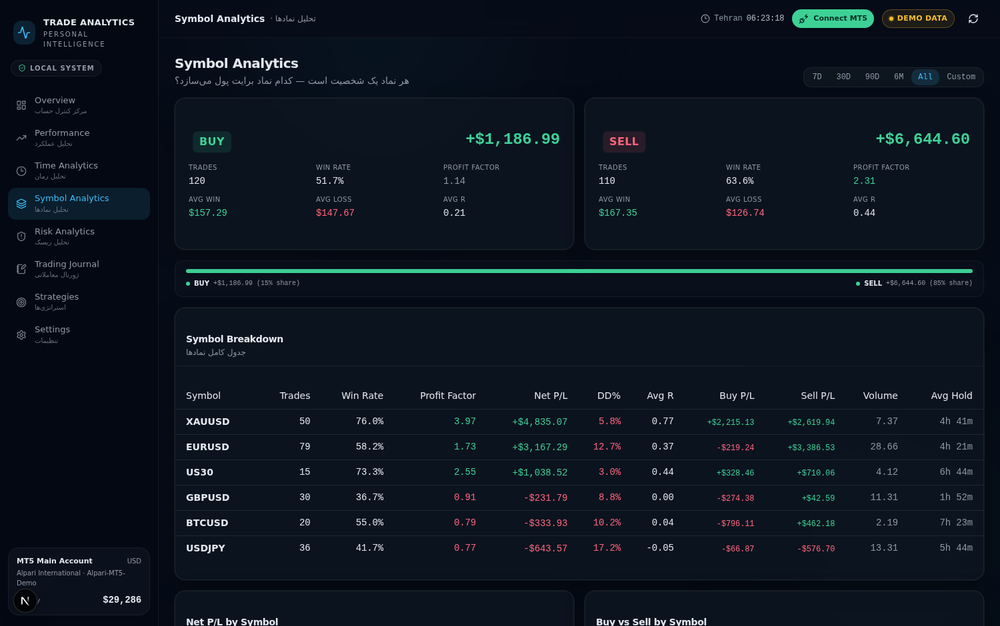
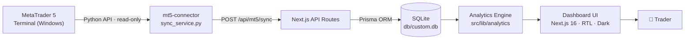

<div align="center">


# Personal Trading Intelligence — هوش معاملاتی شخصی

**داشبورد حرفه‌ای تحلیل معاملات متاتریدر ۵ — کاملاً محلی، فقط‌خواندنی، بدون ابر**

A local-first, read-only MetaTrader 5 trading analytics dashboard.
Built with Next.js 16 · TypeScript · Prisma · SQLite · Electron

[](https://nextjs.org)
[](https://www.typescriptlang.org)
[](https://www.prisma.io)
[](https://www.sqlite.org)
[](https://www.electronjs.org)
[](#-نصب-برنامه-دسکتاپ-ویندوز)
[](LICENSE)
[](https://github.com/realmohamarezaa-netizen/personal-trading-intelligence/actions/workflows/ci.yml)

</div>

---

## 📖 دربارهٔ پروژه

این برنامه تمام معاملات، تراکنش‌ها و وضعیت حساب متاتریدر ۵ شما را **خوانده** و آن‌ها را به یک داشبورد تحلیلی حرفه‌ای تبدیل می‌کند — با زبان فارسی، چیدمان راست‌به‌چپ و تم تاریک. ژورنال معاملاتی دقیقاً همان تاریخچهٔ متاتریدر است، به‌علاوهٔ کمیسیون، سوآپ و سود خالص هر معامله.

> 🔒 **کاملاً محلی:** همهٔ داده‌ها فقط روی کامپیوتر خودتان ذخیره می‌شوند (SQLite). هیچ ابری، هیچ سروری، هیچ تلومتری وجود ندارد.
>
> 🔒 **فقط‌خواندنی:** کانکتور هیچ سفارشی باز نمی‌کند، هیچ پوزیشنی نمی‌بندد و هیچ تغییری در حساب شما نمی‌دهد.

<div align="center">

<p><sub>نمای کلی — Equity Curve، P/L روزانه، عملکرد ماهانه و پوزیشن‌های باز</sub></p>
</div>

---

## ✨ امکانات

| بخش | توضیح |
|---|---|
| 🎛 **Overview — مرکز کنترل حساب** | موجودی، اکوییتی، P/L شناور و روزانه، نرخ برد، فاکتور سود، حداکثر دراودان |
| 📈 **Performance — تحلیل عملکرد** | منحنی اکوییتی، P/L روزانه و ماهانه، تقویم معاملاتی، وین‌استریک و لوس‌استریک، آمار کمیسیون و سوآپ |
| ⏱ **Time Analytics — تحلیل زمان** | عملکرد بر اساس ساعت، روز هفته و ماه؛ کشف بهترین زمان‌های معامله |
| 🔤 **Symbol Analytics — تحلیل نمادها** | عملکرد هر نماد به‌تفکیک خرید/فروش با فیلتر و مرتب‌سازی |
| 🛡 **Risk Analytics — تحلیل ریسک** | توزیع R-Multiple، نسبت ریسک به ریوارد، تحلیل حجم لات، سری‌های برد/باخت |
| 📓 **Trading Journal — ژورنال معاملاتی** | تاریخچهٔ کامل متاتریدر: کمیسیون، سوآپ، سود خالص + یادداشت، اشتباهات و وضعیت روانی برای هر معامله؛ خروجی CSV |
| 🔔 **Insights & Alerts — هشدارها** | کشف خودکار الگوها: وین‌استریک‌ها، اوورتریدینگ، ریسک غیرعادی و… |
| ⚙️ **Settings — تنظیمات** | اتصال MT5، بازهٔ همگام‌سازی، تولید دادهٔ نمونه، مدیریت پایگاه داده، **دانلود فایل نصبی ویندوز** |

<div align="center">
<table>
<tr>
<td></td>
<td></td>
</tr>
<tr>
<td><sub>تحلیل عملکرد — منحنی اکوییتی و آمار کامل</sub></td>
<td><sub>تحلیل نمادها — عملکرد به‌تفکیک نماد</sub></td>
</tr>
</table>
</div>

---

## 🖥 نصب برنامهٔ دسکتاپ (ویندوز ۱۰/۱۱ — ۶۴ بیتی)

تجربهٔ استفاده در ۵ قدم — **بدون VS Code، بدون خط فرمان، بدون اسکریپت:**

```
1. فایل نصب (PTI-Setup.exe) را یک‌بار اجرا کنید.
2. برنامهٔ داشبورد را از منوی استارت باز کنید.
3. متاتریدر ۵ را باز کنید و وارد حساب معاملاتی‌تان شوید.
4. در داشبورد روی دکمهٔ سبز «Connect MT5» کلیک کنید.
5. تمام! معاملات و اطلاعات حساب به‌صورت خودکار دریافت می‌شوند
   و هر ۴۵ ثانیه همگام می‌مانند.
```

<details>
<summary><b>جزئیات فنی بستهٔ نصب</b></summary>

- شِل دسکتاپ: **Electron** — پنجرهٔ نیتیو دور داشبورد (`desktop-build/main.js`)
- سرور Next.js به‌صورت **standalone** داخل بسته قرار می‌گیرد و فقط روی `127.0.0.1:3517` گوش می‌دهد
- کانکتور پایتون با **PyInstaller** به یک `exe` مستقل تبدیل می‌شود — نیازی به نصب پایتون نیست
- نصاب: **NSIS** (`desktop-build/installer.nsi`) — شورتکات استارت‌منو و دسکتاپ، حذف تمیز با پرس‌وجوی حفظ داده‌ها
- اسکریپت‌های آماده‌سازی: `desktop-build/` (ساخت آیکون‌ها، بستهٔ اپ، تنظیمات NSIS)

</details>

### ⬇ دانلود نصاب از داخل خود برنامه

صفحهٔ **Settings** داشبورد یک بخش «دانلود نسخهٔ ویندوز» دارد:

- فایل `PTI-Setup-x.y.z.exe` از مسیر `GET /api/download` به‌صورت جریانی دانلود می‌شود
  (پشتیبانی از **Range** برای ادامهٔ دانلود ناتمام روی فایل‌های حجیم)
- نسخه، حجم دقیق، تاریخ ساخت و **SHA-256** فایل (با دکمهٔ کپی) نمایش داده می‌شود
- اگر فایل نصاب روی آن نصب موجود نباشد، به‌صورت خودکار به
  [GitHub Releases](https://github.com/realmohamarezaa-netizen/personal-trading-intelligence/releases/latest) هدایت می‌شوید
- برای ساخت مجدد نصاب با آخرین کد: `bun run build` و سپس `bash desktop-build/build-installer.sh <version>`

---

## 🚀 راه‌اندازی در حالت توسعه

### پیش‌نیازها

| ابزار | نسخه | توضیح |
|---|---|---|
| [Node.js](https://nodejs.org) | ≥ 20 | یا [Bun](https://bun.sh) ≥ 1.1 |
| [Python](https://www.python.org) | 3.12 (64-bit) | فقط برای کانکتور MT5 — روی ویندوز |
| MetaTrader 5 | آخرین نسخه | ترمینال باید باز و وارد حساب شده باشد |

### مراحل

```bash
# 1) کلون و نصب وابستگی‌ها
git clone https://github.com/realmohamarezaa-netizen/personal-trading-intelligence.git
cd personal-trading-intelligence
npm install          # یا: bun install

# 2) تنظیم محیط
cp .env.example .env # در ویندوز: copy .env.example .env

# 3) پایگاه داده
npm run db:push      # ساخت جداول SQLite
npm run seed         # بارگذاری ۲۴۰ معاملهٔ نمونه (اختیاری)

# 4) اجرا
npm run dev          # → http://localhost:3000
```

### کانکتور MT5 (فقط ویندوز)

```bash
cd mt5-connector
pip install -r requirements.txt

python sync.py --test        # تست اتصال به ترمینال MT5
python sync.py --days 180    # همگام‌سازی ۱۸۰ روز اخیر
python sync.py --watch 60    # همگام‌سازی مداوم هر ۶۰ ثانیه
```

یا از داخل داشبورد: **Settings → Connect MT5** — همگام‌سازی از طریق `POST /api/mt5/sync` انجام می‌شود.

---

## 🏗 معماری



| لایه | تکنولوژی |
|---|---|
| Frontend | Next.js 16 (App Router) · React 19 · Tailwind CSS 4 · shadcn/ui · Recharts · TanStack Query |
| Backend | Next.js API Routes · Prisma ORM |
| Database | SQLite (محلی) — مدل‌ها: `Account`, `Trade`, `Strategy`, `EquitySnapshot`, `CashFlow`, `SyncLog` |
| Connector | Python 3.12 + MetaTrader5 package — فقط‌خواندنی |
| Desktop | Electron shell + NSIS installer (ویندوز ۱۰/۱۱ x64) |

### ساختار پروژه

```
personal-trading-intelligence/
├── src/
│   ├── app/                    # صفحات و API Routes
│   │   └── api/
│   │       ├── analytics/      # موتور تحلیل
│   │       └── mt5/sync/       # همگام‌سازی MT5
│   ├── components/trading/     # کامپوننت‌های داشبورد (۸ بخش)
│   └── lib/                    # analytics · db · seed · types
├── prisma/                     # اسکیمای پایگاه داده
├── db/                         # فایل SQLite (دادهٔ کاربر)
├── mt5-connector/              # کانکتور پایتون (فقط‌خواندنی)
├── desktop-build/              # شِل Electron + نصاب NSIS
├── scripts/                    # دادهٔ نمونه
└── docs/screenshots/           # تصاویر مستندات
```

---

## 🔒 حریم خصوصی و امنیت

- **همه‌چیز محلی است:** داده‌ها فقط در `db/custom.db` ذخیره می‌شوند و هرگز کامپیوتر شما را ترک نمی‌کنند
- **سرور فقط روی `127.0.0.1`:** داشبورد از شبکه بیرونی قابل دسترسی نیست
- **کانکتور فقط‌خواندنی:** بدون اجازهٔ الگوتریدینگ هم کار می‌کند؛ هیچ سفارشی اجرا نمی‌شود
- جزئیات بیشتر در [SECURITY.md](SECURITY.md)

---

## ⚠️ سلب مسئولیت

این ابزار **فقط تحلیلی** است و توصیهٔ سرمایه‌گذاری نیست. عملکرد گذشته تضمینی برای نتایج آینده نیست. مسئولیت تصمیم‌های معاملاتی کاملاً بر عهدهٔ خود شماست.

---

## 📄 مجوز

[MIT](LICENSE) © 2025
